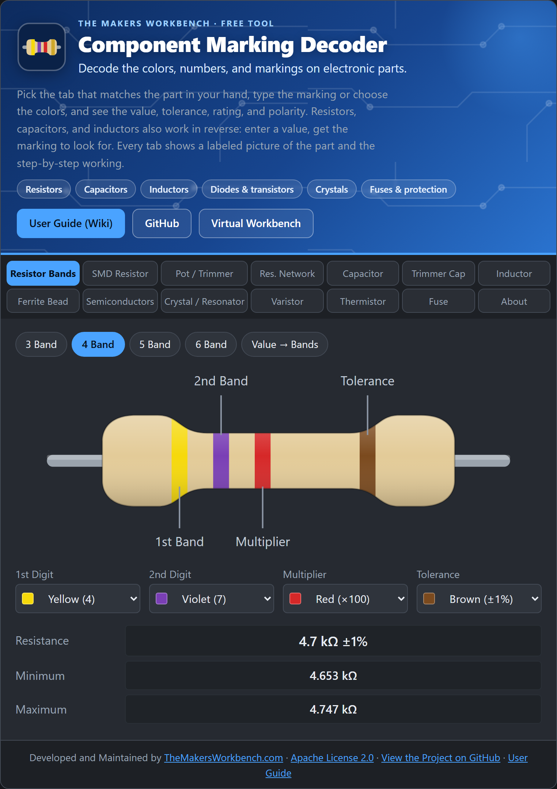

# Component Marking Decoder

Read the codes, colors, and markings printed on electronic parts. Pick the tab for the part in your hand (resistor, capacitor, inductor, diode, crystal, fuse, and more), type the marking or choose the colors, and see the value, tolerance, rating, and polarity with a labeled picture and the step-by-step working.

**Try it online:** [The Makers Workbench Virtual Workbench](https://www.themakersworkbench.com/virtual-workbench)
**User Guide (Wiki):** [github.com/MakersWorkbench/component-marking-decoder/wiki](https://github.com/MakersWorkbench/component-marking-decoder/wiki)

Developed and maintained by [TheMakersWorkbench.com](https://www.themakersworkbench.com).



## What can it decode?

| Tab | What it reads |
|---|---|
| Resistor Bands | 3, 4, 5, and 6 band color codes, tolerance, temperature coefficient, and a reverse mode (type `4.7kΩ 1%`, get the bands) |
| SMD Resistor | 3-digit, 4-digit, EIA-96 (`01C`), R notation (`4R7`), and zero-ohm jumpers (`000`) |
| Pot / Trimmer | Value codes (`B103`) and taper letters |
| Res. Network | SIP, DIP, and SMD resistor array codes, bussed or isolated |
| Capacitor | Ceramic, film, SMD, tantalum, and electrolytic markings, tolerance letters, voltage codes, EIA-198, pF/nF/µF conversion, and value-to-code |
| Trimmer Cap | Printed capacitance ranges |
| Inductor | Number codes (`473J`), R and N notation, color bands, SMD and RF marking dots |
| Ferrite Bead | Impedance codes (`601`) and Murata BLM part numbers |
| Semiconductors | About 120 diodes, transistors, MOSFETs, regulators, and ICs, searchable by part number or SMD marking code |
| Crystal / Resonator | Frequency markings, load capacitors, and a ceramic filter lookup |
| Varistor | `14D471K` and `S14K275` style codes |
| Thermistor | NTC and PTC markings, beta model, and inrush limiters |
| Fuse | IEC 60127 codes (`T2AL250V`) and resettable PTC fuses |

## How do I use it?

1. Open the tool and choose the tab that matches your part.
2. Type the marking printed on the part, or pick the band colors.
3. Read the result, check the labeled picture, and follow the numbered working if you want to see how the code was read.

The [Getting Started](https://github.com/MakersWorkbench/component-marking-decoder/wiki/Getting-Started) page of the wiki has a two-minute walk-through, and every tab has its own guide page.

## Running it locally

There is no build step and there are no dependencies. It is plain HTML, CSS, and JavaScript.

```bash
git clone https://github.com/MakersWorkbench/component-marking-decoder.git
cd component-marking-decoder
python -m http.server 8000
```

Then open `http://localhost:8000`. You can also open `index.html` directly in a browser.

## Embedding it in a page

Copy the folder to your site and include `index.html` in an iframe, or copy the `decoder.css`, `js/`, and the single `<div class="tmwb-dec" id="tmwb-dec"></div>` plus script tags into your page. To show only one tab with no tab bar, link to `index.html?solo#cap` (use `#res`, `#smd`, `#pot`, `#net`, `#cap`, `#tcap`, `#ind`, `#ferr`, `#semi`, `#xtal`, `#mov`, `#therm`, or `#fuse`). The attribution footer always stays. See the [Embedding and Customizing](https://github.com/MakersWorkbench/component-marking-decoder/wiki/Embedding-and-Customizing) wiki page.

**Drupal:** the `drupal/tmwb_component_identifier` folder is a ready-made Drupal 10/11 module (TMWB Component Identifier). It adds a text filter so you can place the tool anywhere in a page with `<div class="tmwb-component-identifier"></div>`. See its [README](drupal/tmwb_component_identifier/README.md).

## Project layout

```
index.html        page shell
decoder.css       all styling, scoped under .tmwb-dec
js/app.js         user interface for every tab and the project info block (APP)
js/resistor-logic.js, smd-logic.js, cap-logic.js, ind-logic.js,
js/passive-logic.js, xtal-logic.js   decoding logic, no dependencies
js/parts-data.js  the semiconductor database
drupal/           the TMWB Component Identifier module for Drupal 10 and 11
scripts/          sync_drupal_module.py keeps the module's copy of the tool current
SOURCES.md        where the tables and values were checked
LICENSE, NOTICE   Apache License 2.0 and the required attribution notices
wiki/             the User Guide pages (published to the GitHub wiki)
```

The decoding logic files have no DOM code, so you can use them in Node (`require('./js/cap-logic.js')`) for testing or in your own projects.

## How accurate is it?

Tables and values were checked against manufacturer datasheets, distributor references, and published standards. The record, including what could not be verified and what varies between manufacturers, is in [SOURCES.md](SOURCES.md). Marking codes, pinouts, and some ratings differ between makers, and the tool says so where it matters. Tolerances read from SMD markings are estimates. Always confirm with the datasheet for your exact part.

## Contributing

Corrections are welcome, especially with a datasheet or standard cited. Open an issue or a pull request. New parts for the semiconductor database go in `js/parts-data.js` using the same entry format as the existing parts. Please include a source for any number you add.

## License

[Apache License 2.0](LICENSE), with attribution notices in the [NOTICE](NOTICE) file. Free for commercial and non-commercial use, and you can modify it and add to it. You must include a copy of the license, keep the copyright and attribution notices (including the NOTICE contents), and mark files you changed. Please also keep the "Developed and Maintained by TheMakersWorkbench.com" footer and project links visible.

## Credits

The layout is inspired by [ResistorDecoder](https://github.com/VoxelCubes/ResistorDecoder) by VoxelCubes. This is an independent implementation, and no code was copied.
