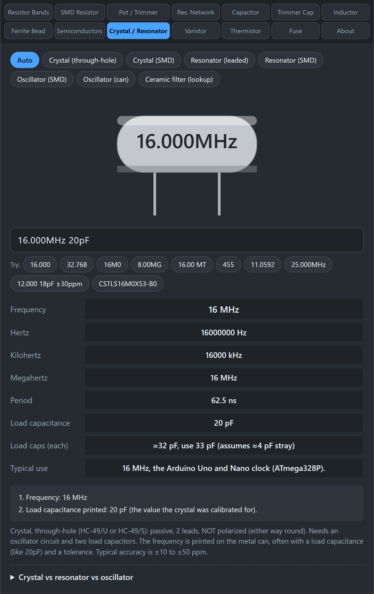
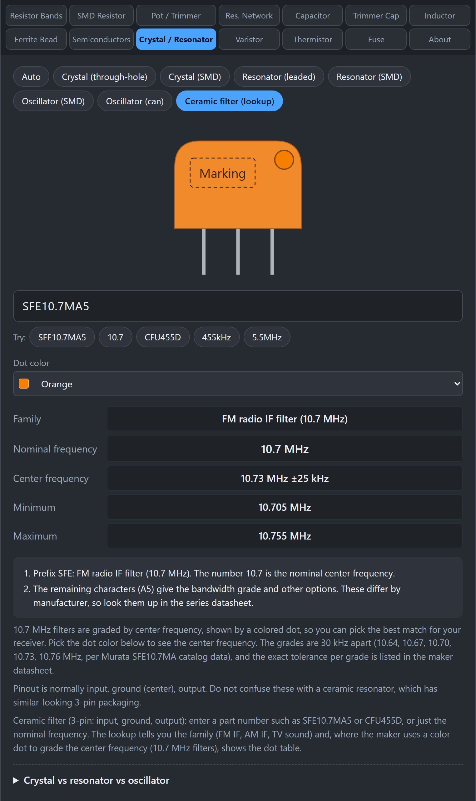

# Crystals and Resonators

This tab reads the markings on parts that set the beat of a circuit: crystals, ceramic resonators, oscillators, and ceramic filters. It also gives you the frequency in every unit, how long one cycle is, and what the frequency is usually used for.

## What are the different parts?

| Part | Passive or active | Accuracy | Needs |
|---|---|---|---|
| Crystal | Passive | High (about ±10 to ±50 ppm) | An oscillator circuit and two load capacitors |
| Ceramic resonator | Passive | Lower (about ±0.5%) | Often nothing extra (3-pin types have built-in capacitors) |
| Oscillator (XO) | Active | Good | Power and ground only, gives a ready clock |
| MEMS oscillator | Active | Good | Power and ground only, very shock resistant |

**Passive** means the part needs a circuit around it to oscillate. **Active** means it has the circuit inside and just needs power.

## How do I use the tab?

*A crystal marked 16.000MHz 20pF shows its frequency in every unit, its period, and suggested load capacitors.*

1. Click **Crystal / Resonator**.
2. Choose the part type, or leave it on **Auto**: Crystal (through-hole), Crystal (SMD), Resonator (leaded), Resonator (SMD), Oscillator (SMD), Oscillator (can), or **Ceramic filter (lookup)**.
3. Type the marking, for example `16.000`, `32.768`, `16M0`, or `16.000MHz 20pF ±30ppm`.
4. Read **Frequency** in Hz, kHz, and MHz, the **Period**, and **Typical use**.

## What markings does it understand?

- **Plain frequency:** `16.000` is read as 16 MHz. `32.768` is read as 32.768 kHz (the standard watch crystal). `455` is read as 455 kHz.
- **Unit as a decimal point:** `16M0` is 16.0 MHz and `4M096` is 4.096 MHz. `32K768` is 32.768 kHz.
- **Frequency plus series code:** `8.00MG` is 8 MHz with a series or tolerance code. `16.00 MT` is 16 MHz with the letters printed by the maker.
- **Extra details:** `20pF` is the load capacitance the crystal was calibrated for. `±30ppm` is the stability. The tool shows how far off the frequency can be, in Hz.
- **Murata resonator part numbers:** `CSTLS16M0X53-B0` reads as a 3-terminal leaded resonator with built-in capacitors at 16 MHz.

## How do load capacitors work?

A crystal oscillates at its rated frequency only when it sees the load capacitance it was made for. If a load of 20 pF is printed, you add two capacitors, one from each crystal pin to ground. The tool uses the common formula, assuming about 4 pF of stray capacitance from the board:

each capacitor = 2 x (load capacitance − stray capacitance)

For 20 pF that is 2 x (20 − 4) = 32 pF, so use the nearest standard value, 33 pF.

## What is the Ceramic filter lookup?

*The ceramic filter lookup identifies the family and, for 10.7 MHz filters, maps the dot color to the center frequency.*

Ceramic filters are 3-pin parts used in radios. Choose **Ceramic filter (lookup)** and type either a part number such as `SFE10.7MA5` or `CFU455D`, or a nominal frequency such as `10.7`, `455kHz`, or `5.5MHz`. The tool tells you the family: FM IF (10.7 MHz), AM IF (455 kHz), or TV sound IF (4.5 to 6.5 MHz range), and the center frequency.

For 10.7 MHz filters, a **colored dot** marks the center frequency grade, so you can choose the dot color to see it: black 10.64 MHz, blue 10.67, red 10.70, orange 10.73, and white 10.76 MHz.

## What do the pins mean?

- **Crystal:** two pins, not polarized. Either way round works.
- **SMD crystal (4 pad):** use the two diagonal pads. The other two are case ground or not connected. A dot marks pin 1.
- **Ceramic resonator (3 pin):** the middle pin is ground. The outer two are interchangeable.
- **Oscillator (SMD, 4 pad):** a dot marks pin 1, counted counter-clockwise. A common pinout is 1 enable (or not connected), 2 ground, 3 output, 4 supply. Some makers differ, so check the datasheet.
- **Oscillator (can):** a corner dot or notch marks pin 1. Full size: 1 enable, 7 ground, 8 output, 14 supply. Half size: 1 enable, 4 ground, 5 output, 8 supply.

## Gotchas

- **No unit printed.** The tool guesses: small numbers are MHz, 32.768 is kHz, and numbers in the hundreds are kHz. It shows the assumption in the working.
- **Series letters are not decoded.** Letters after the frequency are maker codes. Check the maker's datasheet for the meaning.
- **Date codes on oscillators are not decoded.** They are manufacturer specific.
- **Ceramic filter dots depend on the family.** The dot table applies to 10.7 MHz filters. Other families use other grades.

## Related guides

[Trimmer Capacitor](Trimmer-Capacitor), [Semiconductors](Semiconductors).
