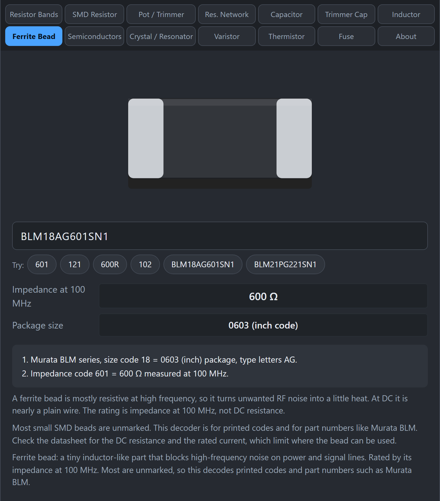

# Ferrite Bead

A ferrite bead is a small part that blocks high-frequency noise on a power or signal line. At low frequencies and DC it acts almost like a plain wire, but at high frequencies it behaves like a resistor and turns the noise into a tiny amount of heat.

## What does the marking mean?

A bead is rated by its **impedance at 100 MHz**, not by its DC resistance. When a code is printed, it works like a resistor code.

- `601` = 60 x 10 = 600 Ω at 100 MHz.
- `121` = 12 x 10 = 120 Ω at 100 MHz.
- `600R` = 600 Ω at 100 MHz.

Most small SMD beads are **unmarked**, so this tab is most useful for printed codes and for part numbers such as Murata's BLM series.

## How do I use the tab?

*A Murata BLM18AG601SN1 is a 0603 bead with 600 Ω impedance at 100 MHz.*

1. Click **Ferrite Bead**.
2. Type the code or part number, for example `601`, `121`, `600R`, `BLM18AG601SN1`, or `BLM21PG221SN1`.
3. Read **Impedance at 100 MHz** and, for BLM parts, the **Package size**.

## What do Murata BLM part numbers mean?

Take `BLM18AG601SN1`:

- **BLM**: Murata chip ferrite bead.
- **18**: the size code, here the 0603 package. Confirmed codes: 15 = 0402, 18 = 0603, 21 = 0805, 41 = 1806. If the tool does not know a size code, it tells you to check the datasheet.
- **AG**: the type letters (series and characteristics).
- **601**: 600 Ω at 100 MHz.
- **SN1** and any trailing letters: other options and packaging. Look these up in the Murata datasheet.

## Gotchas

- **Do not pick a bead only by impedance.** Check the DC resistance and the rated current in the datasheet. A bead that is too small can overheat on a power rail.
- **Different from an inductor.** A bead is meant to lose energy at high frequency. An inductor is meant to store it.
- **Impedance changes with frequency.** The 100 MHz figure is a reference point, not the value at every frequency.

## Related guides

[Inductor](Inductor).
