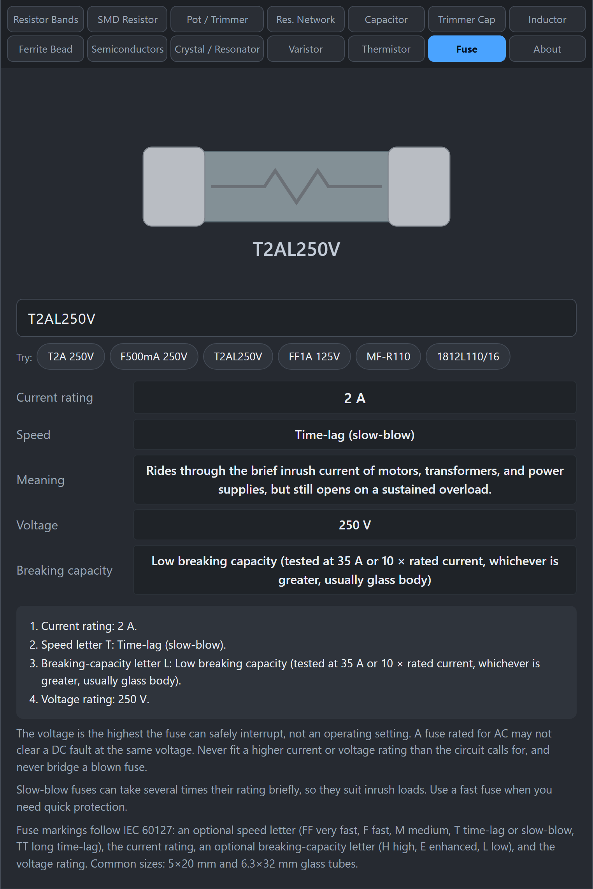
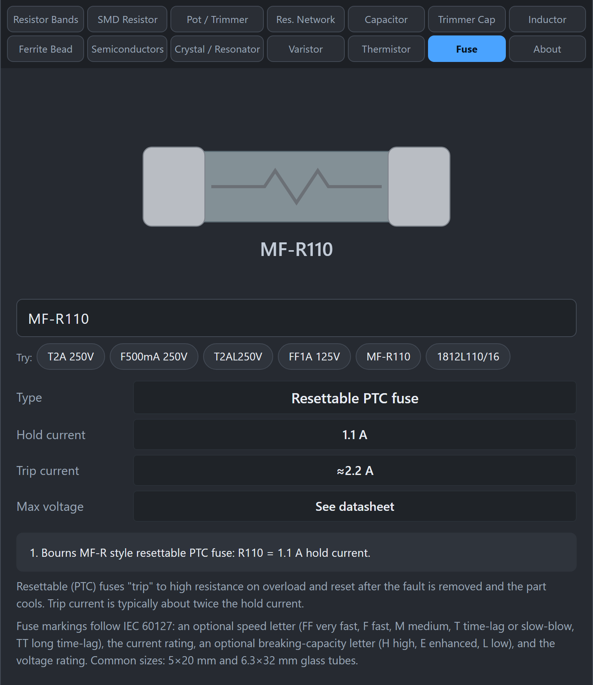

# Fuse

A fuse is a deliberate weak link. If too much current flows, the fuse element melts and opens the circuit, protecting everything behind it. This tab reads fuse markings, including resettable (PTC) fuses.

## How do the markings work?

Standard small cartridge fuses follow IEC 60127 and are marked in this order: speed letter, current rating, breaking-capacity letter, voltage. For example `T2AL250V`.

### Speed letter

| Letter | Meaning | Good for |
|---|---|---|
| FF | Very fast-acting | Delicate semiconductor and meter circuits |
| F | Fast-acting | General electronics with no big surge current |
| M | Medium time-lag | Small surges |
| T | Time-lag (slow-blow) | Motors, transformers, and power supplies, which draw a brief surge when they start |
| TT | Long time-lag | Even more surge tolerant |

### Current rating

The current it should carry continuously, such as `2A` or `500mA`.

### Breaking-capacity letter

How much fault current the fuse can safely interrupt:

- **L**: low, tested at 35 A or 10 times the rated current, whichever is greater (usually a glass tube)
- **E**: enhanced, tested at 150 A
- **H**: high, tested at 1500 A (usually a ceramic tube)

### Voltage

The highest voltage the fuse can safely interrupt. It is not an operating setting. A fuse rated for AC may not safely clear a DC fault at the same voltage.

## How do I use the tab?

*T2AL250V is a 2 A time-lag fuse, 250 V, low breaking capacity.*

1. Click **Fuse**.
2. Type the marking, for example `T2A 250V`, `F500mA 250V`, `T2AL250V`, `FF1A 125V`, `MF-R110`, or `1812L110/16`.
3. Read the current rating, speed, meaning, voltage, and breaking capacity.

## What about resettable fuses?

*MF-R110 is a resettable fuse with a 1.1 A hold current and about 2.2 A trip current.*

Resettable fuses (also called polyfuses or PTC fuses) do not blow. They heat up and switch to high resistance during an overload, then reset after the fault is removed and they cool down.

- `MF-R110` (Bourns) means a **hold current** of 1.10 A. The trip current is about twice the hold current.
- `1812L110/16` (Littelfuse) means a 1812-size SMD part with 1.10 A hold current and a 16 V rating.

The **hold current** is the most the part carries without tripping. The **trip current** is the current at which it switches to high resistance.

## Gotchas

- **Never fit a bigger fuse to stop it blowing.** A fuse that keeps blowing is telling you something is wrong. A bigger one can let a fire start.
- **Match the speed.** A fast fuse in a circuit with a power-on surge blows needlessly. A slow-blow fuse in a delicate circuit may not protect it.
- **Voltage and current both matter.** Never use a fuse with a lower voltage rating than the circuit.
- **Mains safety.** Mains voltage is dangerous. Use fuses from reputable makers with the right approvals.

## Related guides

[Varistor](Varistor), [Thermistor](Thermistor).
