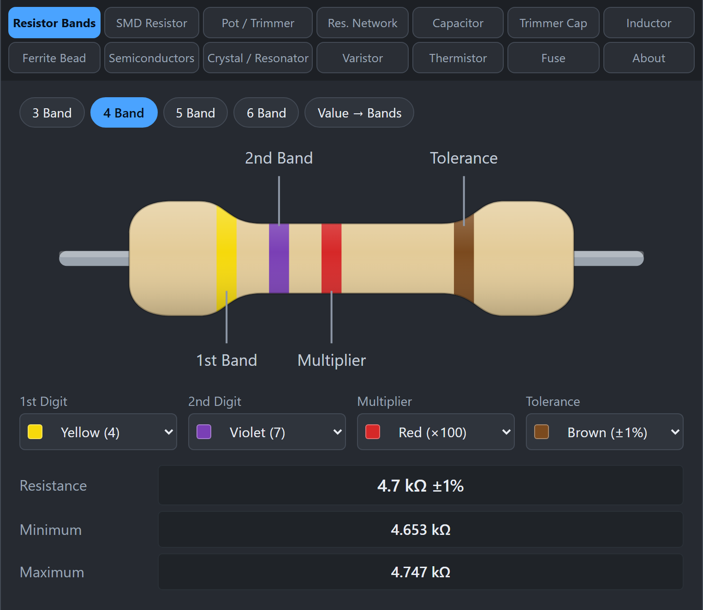
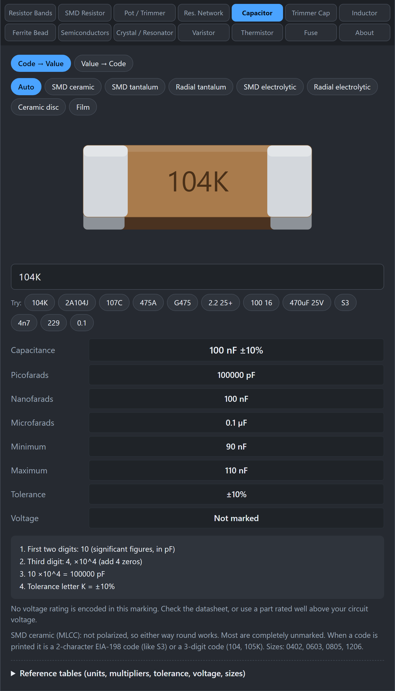
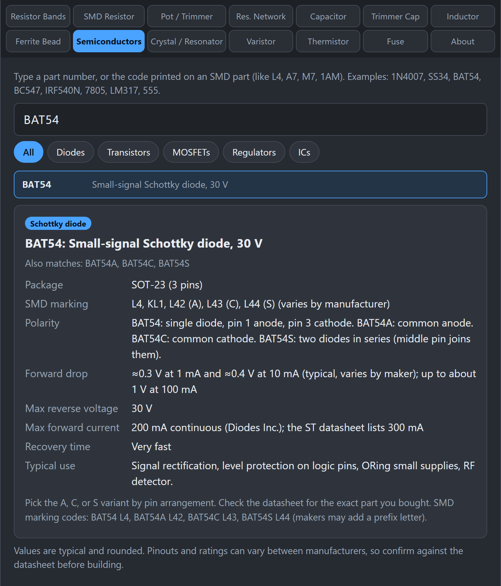

# Getting Started

This is the two-minute tour. By the end you will have decoded a resistor, a capacitor, and a diode.

## What am I looking at?

*The whole tool: the title and description, the two rows of tabs, a labeled picture of the part, the controls, and the results.*

When you open the tool you see a title, a short description, and a grid of tabs in two rows. Each tab is for one kind of part. Under the tabs is the main area, which always has the same layout:

1. **A picture of the part**, labeled, so you know you picked the right tab.
2. **Controls**: either dropdowns for colors or a box where you type the marking.
3. **Results**: the value, tolerance, and other details in neat rows.
4. **The working**: a numbered list showing how the code was read, and notes about gotchas.

Many tabs have a row of **Try** buttons. Click one to fill in a real example and see what the result looks like.

## How do I read a resistor with colored stripes?

*Yellow, violet, red, brown on a 4-band resistor gives 4.7 kΩ ±1%.*

1. Click the **Resistor Bands** tab.
2. Choose how many stripes your resistor has: **3 Band**, **4 Band**, **5 Band**, or **6 Band**.
3. For each stripe, pick its color from the dropdown. Start from the stripe nearest one end. The tolerance stripe (often gold or silver) goes on the right.
4. Read the **Resistance**, **Minimum**, and **Maximum** rows.

Try this: choose **4 Band** and set yellow, violet, red, brown. You get 4.7 kΩ ±1%.

**Gotcha:** if you cannot tell which end to start from, look for the stripe that sits farther from the others. That one is the tolerance stripe, and it goes on the right.

## How do I find the stripes for a value I need?

Click **Value → Bands** and type a value such as `4.7kΩ 1%`. The tool shows the resistor with the right stripes in order and lists them. This is handy when you are shopping or sorting parts.

## How do I read a number printed on a small part?

*Typing 104K on the Capacitor tab gives 100 nF ±10%, with the working underneath.*

1. Click the tab for your part (for example **Capacitor**).
2. Type exactly what is printed, for example `104K`.
3. Read the results, then check the working below them.

Try this: on the **Capacitor** tab, type `104K`. You get 100 nF, ±10%. The working explains that the first two digits (10) are the value, the third digit (4) means add four zeros, which is 100,000 pF, and the letter K means ±10%.

## How do I look up a diode or transistor?

*The Semiconductors tab shows polarity, package, ratings, and typical use.*

1. Click **Semiconductors**.
2. Type the part number, such as `1N4007`, `BC547`, or `IRF540N`. You can also type a short marking printed on an SMD part, such as `L4` or `A7`.
3. Click the match in the list. You get the polarity or pinout, package, main ratings, and typical use.

Use the filter chips (Diodes, Transistors, MOSFETs, Regulators, ICs) to narrow a broad search.

## What if the tool says it cannot read my marking?

Check these first:

- Did you type it exactly as printed, including letters? Spaces and dashes are usually fine.
- Are you on the right tab? A `103` on a capacitor and a `103` on a resistor mean different things.
- Is the marking a private code? Some manufacturers use codes that only their datasheet explains. The tool will say so when it recognizes the pattern but cannot decode it.

## Can I trust the numbers?

The values were checked against datasheets and published standards, and where manufacturers differ, the tool tells you. Even so, confirm with the datasheet for your exact part, and measure parts with a meter when it matters. Read [Accuracy and Sources](Accuracy-and-Sources) for details.

## What next?

Pick the guide for your part from the [Home](Home) page. Each guide shows worked examples and the gotchas to watch for.
