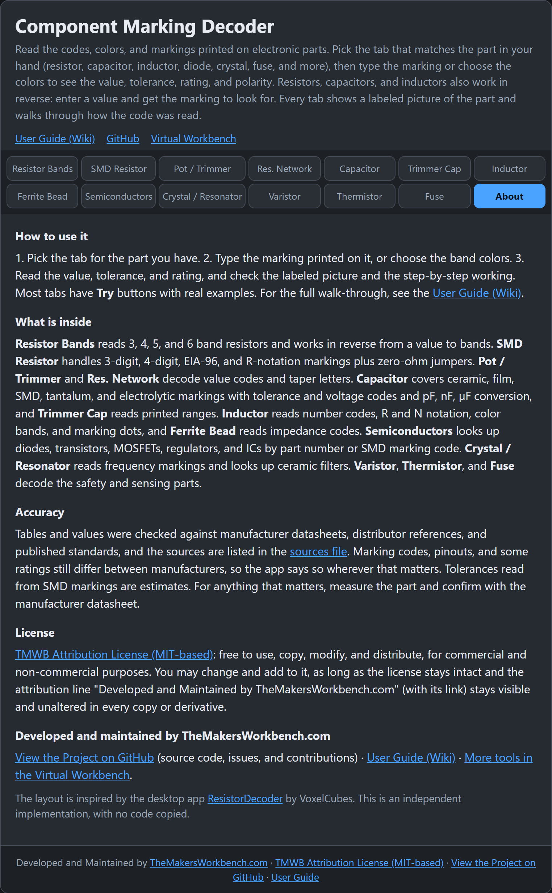

# Component Marking Decoder: User Guide

Welcome. This guide explains how to use the **Component Marking Decoder**, a free tool from [TheMakersWorkbench.com](https://www.themakersworkbench.com) that reads the colors, numbers, and letters printed on electronic parts.

You can try the tool right now in the [Virtual Workbench](https://www.themakersworkbench.com/virtual-workbench).

## Why does this exist?

Electronic parts are small, and the people who make them did not leave much room to write on them. So they use short codes. A tiny rectangle that says `103` might be a 10 kΩ resistor or a 10 nF capacitor, depending on what kind of part it is. A resistor with five colored stripes needs a chart to read. A diode with `L4` stamped on it could be one of several things.

This tool does the lookup for you, shows you a labeled picture of the part, and walks through how it read the code, so you learn the pattern as you go.

## Where do I start?

- New here? Read [Getting Started](Getting-Started). It takes two minutes.
- Know what part you have? Jump to its guide below.
- Wondering how much to trust the numbers? Read [Accuracy and Sources](Accuracy-and-Sources).

## Guides for each tab

**Resistors**
- [Resistor Bands](Resistor-Bands): 3, 4, 5, and 6 band color codes, and value to bands
- [SMD Resistor](SMD-Resistor): `472`, `1002`, `01C`, `4R7`, `000`
- [Pot and Trimmer](Pot-and-Trimmer): `B103`, `A504`
- [Resistor Networks](Resistor-Networks): SIP, DIP, and SMD arrays

**Capacitors, inductors, and ferrites**
- [Capacitor](Capacitor): ceramic, film, SMD, tantalum, and electrolytic
- [Trimmer Capacitor](Trimmer-Capacitor): `5-30` style ranges
- [Inductor](Inductor): number codes, color bands, and marking dots
- [Ferrite Bead](Ferrite-Bead): `601`, `BLM18AG601SN1`

**Semiconductors and timing**
- [Semiconductors](Semiconductors): diodes, transistors, MOSFETs, regulators, and ICs
- [Crystals and Resonators](Crystals-and-Resonators): frequency markings, oscillators, and ceramic filters

**Protection and sensing**
- [Varistor](Varistor): `14D471K`
- [Thermistor](Thermistor): `103`, `NTC 10K B3950`
- [Fuse](Fuse): `T2AL250V`, `MF-R110`

**More**
- [FAQ](FAQ)
- [Embedding and Customizing](Embedding-and-Customizing)
- [License](License)

## Who makes this?

*The About tab shows how to use the tool, the license, and the maintainer and project links.*

Developed and maintained by [TheMakersWorkbench.com](https://www.themakersworkbench.com). The [source code is on GitHub](https://github.com/MakersWorkbench/component-marking-decoder), and contributions and corrections are welcome.
