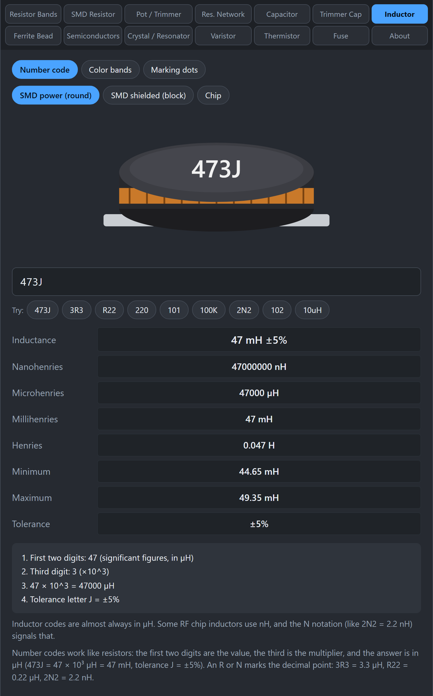
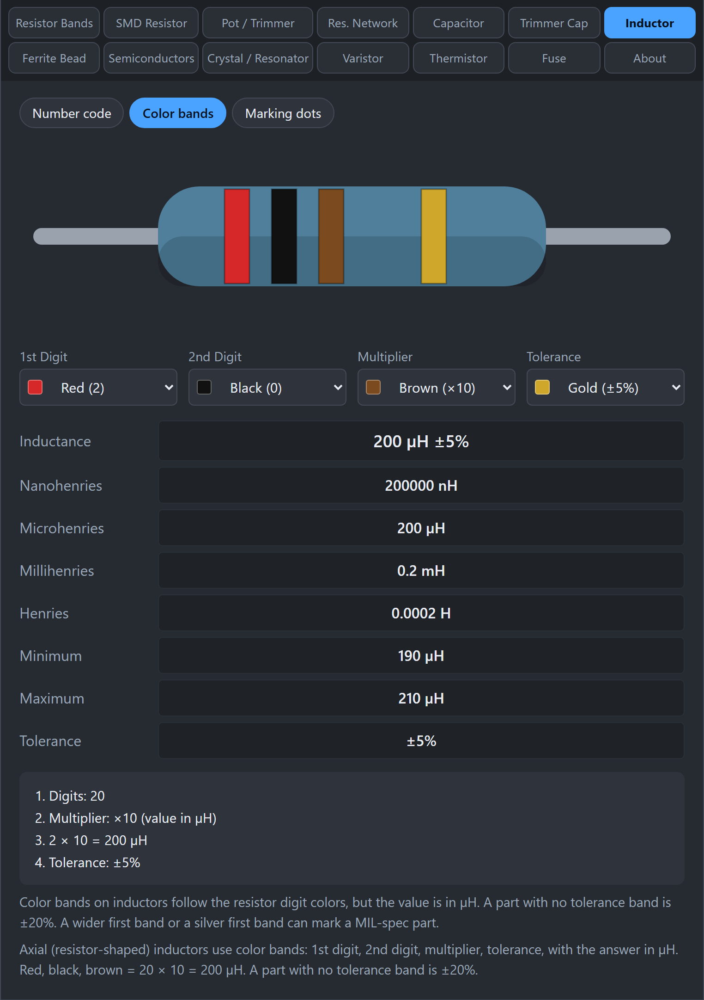
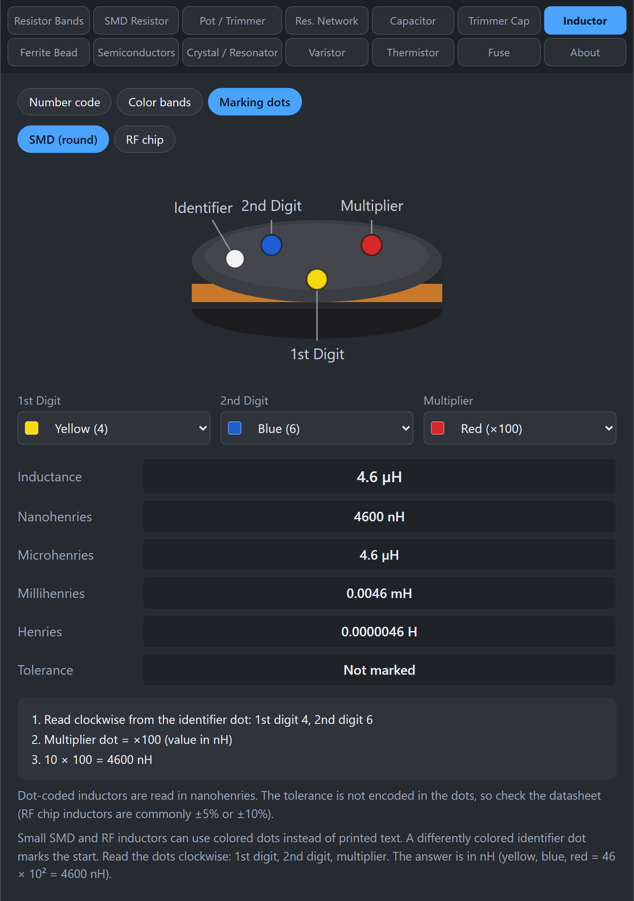

# Inductor

An inductor is a coil of wire that stores energy in a magnetic field. This tab decodes the three ways inductors are marked: printed number codes, color bands, and colored dots.

## What units does an inductor use?

| Unit | Symbol | In henries |
|---|---|---|
| Nanohenry | nH | 10⁻⁹ |
| Microhenry | µH | 10⁻⁶ |
| Millihenry | mH | 10⁻³ |
| Henry | H | 1 |

1 mH = 1,000 µH = 1,000,000 nH. The tool shows every unit.

## How do I use the tab?

1. Click **Inductor**.
2. Pick **Number code**, **Color bands**, or **Marking dots**.
3. Enter the marking or choose the colors, then read **Inductance**, the conversions, and the **Tolerance**.

## What do the number codes mean?

*473J is 47 mH ±5%. Choose the picture that matches your part.*

Most inductor codes are in **microhenries (µH)**.

- **3 digits:** the first two are the value and the third is the number of zeros. `101` = 100 µH. `102` = 1,000 µH = 1 mH. `473` = 47,000 µH = 47 mH.
- **A tolerance letter** can follow: F ±1%, G ±2%, H ±3%, J ±5%, K ±10%, M ±20%. `473J` is 47 mH ±5%. `100K` is 10 µH ±10%.
- **R is a decimal point in µH.** `3R3` = 3.3 µH. `R22` = 0.22 µH. `4R7` = 4.7 µH.
- **N is a decimal point in nH.** `2N2` = 2.2 nH, used for small RF chip inductors.
- You can also type a value with a unit, like `10uH`.

Choose the picture style (**SMD power (round)**, **SMD shielded (block)**, or **Chip**) to match what you are holding.

## How do color bands work?

*Red, black, brown, gold is 200 µH ±5%.*

Axial inductors (the ones shaped like a resistor) use color bands, with the answer in µH:

1. 1st digit
2. 2nd digit
3. Multiplier
4. Tolerance

The digits use the resistor color codes. For the multiplier, black is x1, brown x10, red x100, orange x1,000, yellow x10,000, gold x0.1, and silver x0.01. Tolerance is brown ±1%, red ±2%, gold ±5%, and silver ±10%. A part with no tolerance band is ±20%.

**Example:** red, black, brown, gold is 20 x 10 = 200 µH ±5%.

A wider first band, or a silver first band, can mark a military-spec part.

## How do marking dots work?

*Yellow, blue, red dots read as 4,600 nH (4.6 µH). The identifier dot marks where to start.*

Some small SMD and RF inductors have colored dots instead of printed text. One dot, a different color or marked as the identifier, shows the start. Read the others clockwise from it:

1. 1st digit
2. 2nd digit
3. Multiplier

The answer is in **nanohenries (nH)**. **Example:** yellow, blue, red is 4, 6, x100 = 4,600 nH = 4.6 µH.

In the tool, pick **SMD (round)** or **RF chip** to see the matching picture, and choose the three dot colors. The identifier dot is shown but is not part of the value.

## Gotchas

- **The units differ by scheme.** Number codes and color bands are in µH. Marking dots and N notation are in nH. The tool states the unit in the working.
- **Dots do not give a tolerance.** The tool says "Not marked". Check the datasheet (RF chip inductors are commonly ±5% or ±10%).
- **Clockwise from the identifier.** If the result looks wrong, try reading from the other direction, and check the datasheet. Conventions vary.
- **Do not mix it up with a capacitor.** A `473` part could be a 47 mH inductor or a 47 nF capacitor. The shape and the context tell you which.

## Related guides

[Ferrite Bead](Ferrite-Bead), [Capacitor](Capacitor).
