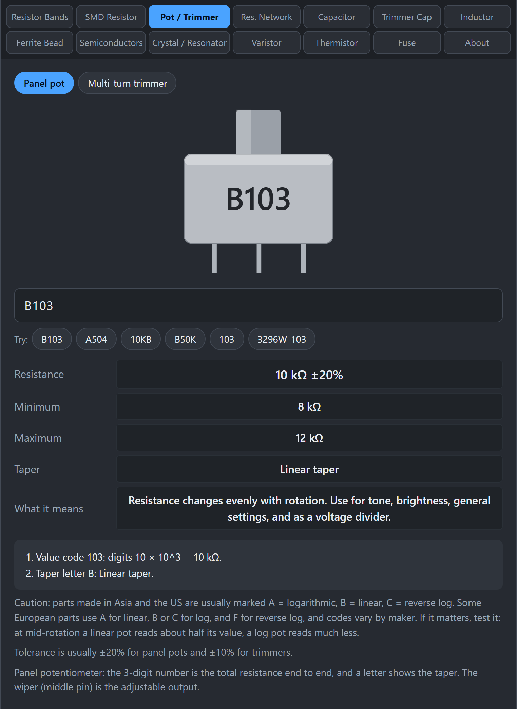

# Pot and Trimmer

Potentiometers ("pots") are adjustable resistors with a knob, and trimmers are tiny ones you adjust with a screwdriver. This tab reads their markings.

## What do the markings mean?

A pot's marking has two parts: the total resistance and a letter for the **taper**.

**Total resistance** is the resistance from one outer pin to the other. It can be a 3-digit code (the same as SMD resistors) or a short number.

- `103` means 10 kΩ.
- `504` means 500 kΩ.
- `10K` also means 10 kΩ.

**Taper** is how the resistance changes as you turn the knob.

- **Linear (B):** the resistance changes evenly with rotation. Halfway around gives about half the resistance. Good for brightness, tone, and as a voltage divider.
- **Logarithmic or audio (A):** the resistance changes slowly at first and faster at the end, which matches how our ears hear loudness. Good for volume controls.
- **Reverse logarithmic (C):** rare. It changes fast at first and slowly at the end.

## How do I use the tab?

*B103 is a 10 kΩ potentiometer with a linear taper.*

1. Click **Pot / Trimmer**.
2. Choose **Panel pot** or **Multi-turn trimmer** to match what you have (this changes the picture and the typical tolerance).
3. Type the marking, for example `B103`, `A504`, `10KB`, `B50K`, or `3296W-103`.
4. Read **Resistance**, **Minimum**, **Maximum**, and **Taper**.

The tool also understands the words `LIN` and `LOG` if you type them.

## Examples

| Marking | Result |
|---|---|
| `B103` | 10 kΩ, linear taper |
| `A504` | 500 kΩ, logarithmic (audio) taper |
| `10KB` | 10 kΩ, linear taper |
| `3296W-103` | 10 kΩ, multi-turn trimmer (W marks a linear multi-turn series at Bourns) |

## Gotchas

- **The letters are not universal.** Parts made in Asia and the US usually follow A = log, B = linear, C = reverse log. Some European parts use A for linear and B or C for log. If you are not sure where a part came from, test it.
- **How to test the taper.** With a meter across one outer pin and the middle pin, turn the pot to the middle of its travel. A linear pot reads about half its total value. A log pot reads much less, often 10 to 20 percent.
- **Tolerance is loose.** Panel pots are typically ±20%, and trimmers ±10%. Do not expect exactly 10.00 kΩ.
- **The middle pin is the wiper.** The wiper is the adjustable output. The outer two pins are the ends of the resistance.

## Related guides

[Resistor Networks](Resistor-Networks), [Resistor Bands](Resistor-Bands).
