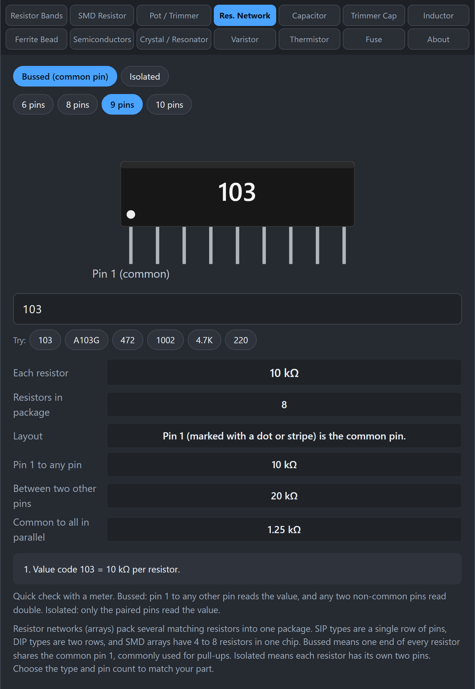

# Resistor Networks

A resistor network (or resistor array) packs several matching resistors into one part. You see them as a single row of pins (SIP), two rows (DIP), or a small SMD chip. They save space when you need many identical resistors, such as pull-ups on a bus.

## What do the markings mean?

The value is usually a 3-digit code, the same as SMD resistors: the first two digits are the value and the third is the number of zeros. `103` is 10 kΩ per resistor. A 4-digit code works the same way with three significant digits, so `1002` is 10 kΩ.

Some parts also carry a tolerance letter (F = ±1%, G = ±2%, J = ±5%, K = ±10%, and so on), for example `A103G` is 10 kΩ at ±2%. A leading letter such as `A` often marks the circuit type, but the letters vary between makers.

## What does bussed or isolated mean?

- **Bussed:** one end of every resistor connects to a shared common pin. This is pin 1, marked with a dot or stripe. It is the usual choice for pull-up or pull-down arrays.
- **Isolated:** each resistor has its own two pins, such as pins 1 and 8 on an 8-pin part. It behaves like separate resistors in one package.

## How do I use the tab?

*Choose bussed or isolated and the pin count. The results include what to expect with a meter.*

1. Click **Res. Network**.
2. Choose **Bussed** or **Isolated**, and the pin count (6, 8, 9, or 10 pins) to match your part.
3. Type the marking, for example `103`, `472`, or `A103G`.
4. Read **Each resistor**, **Resistors in package**, and the layout notes. For bussed parts you also get the readings to expect with a meter.

## How do I check a network with a meter?

Bussed network with value R:

- Pin 1 to any other pin reads **R**.
- Any two non-common pins read **2R** (the signal passes through two resistors).
- If you tie all the other pins together, the common pin to that bundle reads R divided by the number of resistors.

Isolated network: only the paired pins read R, and every other combination is open.

If your meter readings do not match, you probably have the other type, or a different value.

## Gotchas

- **Pin 1 matters.** Pin 1 is marked with a dot or a stripe. On a bussed network it is the common pin, so putting the part in backwards changes the circuit.
- **Pin count versus resistor count.** A 9-pin bussed SIP has 8 resistors, because one pin is the common. An 8-pin isolated part has 4.
- **The tool cannot see inside.** The circuit type is your choice, because the markings do not always say. Use the meter test to be sure.

## Related guides

[SMD Resistor](SMD-Resistor), [Pot and Trimmer](Pot-and-Trimmer).
