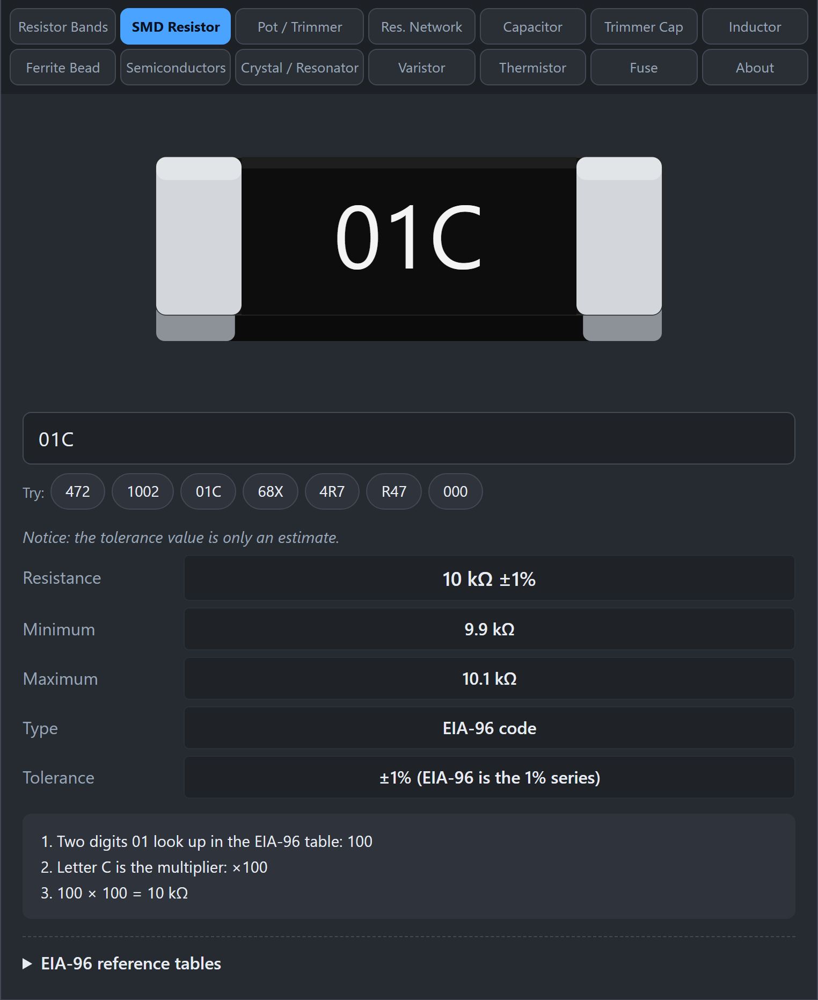
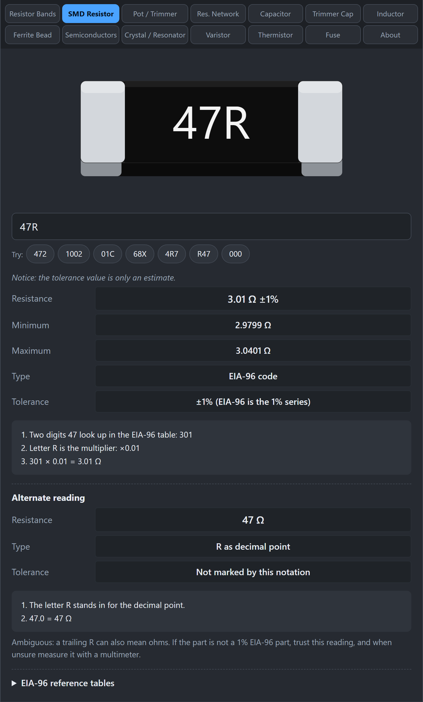

# SMD Resistor

Surface-mount (SMD) resistors are tiny rectangles with the value printed as a short code. This tab decodes those codes.

## How do SMD resistor codes work?

The code is a very small version of the same idea as the color bands. Digits give the value and one character gives the multiplier. There are four styles.

### 3-digit code

The first two digits are the value and the third is the number of zeros to add.

- `472` is 47 followed by two zeros, so 4,700 Ω, or 4.7 kΩ.
- `103` is 10 followed by three zeros, so 10 kΩ.
- Tolerance is typically ±5%.

### 4-digit code

The first three digits are the value and the fourth is the number of zeros.

- `1002` is 100 followed by two zeros, so 10 kΩ.
- Tolerance is typically ±1%, and can be tighter on precision parts.

### EIA-96 code (two digits and a letter)

Precision (1%) resistors that are too small for four digits use a lookup. The two digits pick one of 96 standard values, and the letter is the multiplier.

- `01C`: code 01 means 100, letter C means x100, so 10,000 Ω, or 10 kΩ.
- `68X`: code 68 means 499, letter X means x0.1, so 49.9 Ω.

The tool includes the full table of 96 values. Open **EIA-96 reference tables** under the results, and tap any entry to try it.

Multiplier letters: Z = x0.001, Y or R = x0.01, X or S = x0.1, A = x1, B or H = x10, C = x100, D = x1000, E = x10000, F = x100000.

### R notation

An `R` marks where the decimal point goes. It is common for low values.

- `4R7` is 4.7 Ω.
- `R47` is 0.47 Ω.
- `10R0` is 10.0 Ω.

You may also see `K` or `M` used the same way, such as `4K7` for 4.7 kΩ.

### Zero-ohm jumpers

`0`, `000`, and `0000` (and `0R0`) mean a zero-ohm resistor. It is just a wire link in a resistor package, used to bridge two pads on a circuit board.

## How do I use the tab?

*The chip picture shows your code. 01C is an EIA-96 code for 10 kΩ ±1%, with the working below.*

1. Click **SMD Resistor**.
2. Type the marking in the box. The black chip picture updates to show your code.
3. Read **Resistance**, **Minimum**, **Maximum**, **Type**, and **Tolerance**. The numbered working shows how the code was read.

## Gotchas

*An ambiguous marking like 47R shows both readings: EIA-96 (3.01 Ω) and R notation (47 Ω).*

- **`47R` is ambiguous.** It can be an EIA-96 code (3.01 Ω) or 47 Ω in R notation. The tool shows both readings. If you cannot tell, measure it.
- **Tolerance is an estimate.** Most SMD markings do not encode tolerance. The tool gives the typical tolerance for that style and says so.
- **Tiny parts have no marking.** Resistors in 0402 size and smaller are often blank. Nothing can be decoded, so measure it out of circuit.
- **Do not confuse with capacitors.** SMD capacitors are usually unmarked, and a number on a part does not tell you what kind it is. Check the Capacitor tab if the part is not a resistor.

## Related guides

[Resistor Bands](Resistor-Bands), [Resistor Networks](Resistor-Networks).
