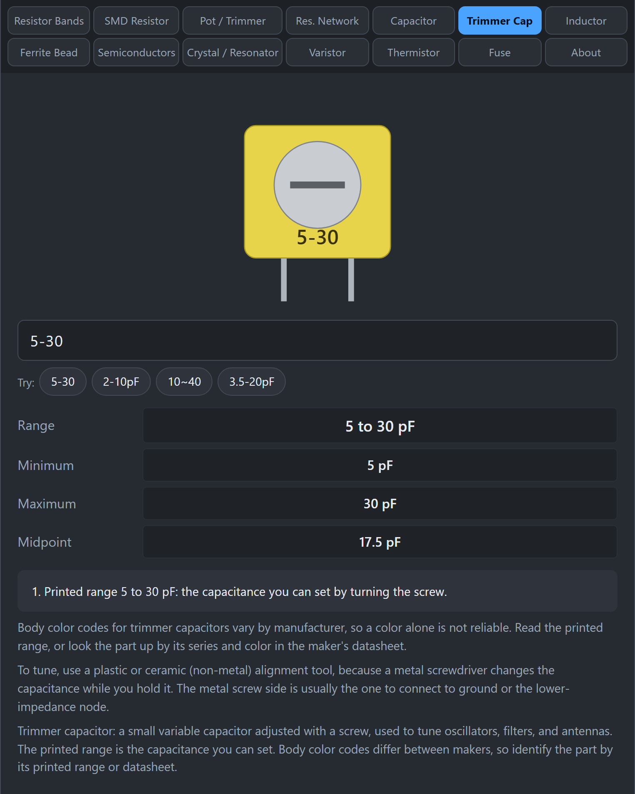

# Trimmer Capacitor

A trimmer capacitor is a small variable capacitor you adjust with a screw. Radio builders use them to tune oscillators, filters, and antennas to exactly the right frequency.

## What does the marking mean?

Unlike a fixed capacitor, a trimmer does not have one value. It has a range, and the range is printed on the part, for example `5-30` or `2-10pF`. That means you can set any capacitance from 5 pF up to 30 pF by turning the screw.

## How do I use the tab?

*Type the printed range to see the minimum, maximum, and midpoint.*

1. Click **Trimmer Cap**.
2. Type the printed range, such as `5-30`, `2-10pF`, `10~40`, or `3.5-20pF`.
3. Read **Range**, **Minimum**, **Maximum**, and **Midpoint**.

## What about the body color?

Many trimmers have a colored body, and some people use the color to guess the range. The colors are **not standard**. They differ from manufacturer to manufacturer, so a color alone is not reliable. Read the printed range, or look up the part in its datasheet.

## How do I adjust one?

- Use a plastic or ceramic alignment tool. A metal screwdriver changes the capacitance while you are holding it, so the setting jumps when you remove it.
- Turn slowly while watching the circuit's response (a frequency reading, a signal strength, a filter peak).
- On many trimmers one terminal is connected to the screw. Connect that side to ground or to the lower-impedance node so your hand and tool do less to the circuit.

## Related guides

[Capacitor](Capacitor), [Crystals and Resonators](Crystals-and-Resonators).
